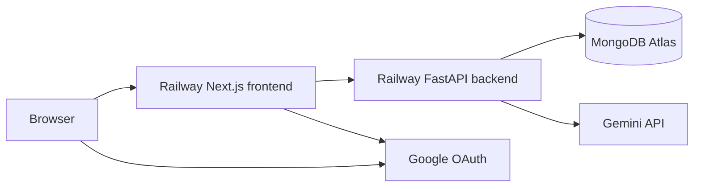

# Deploy InterviewGPT AI on Railway

Monorepo: deploy **two Railway services** from one GitHub repo  
[https://github.com/nik2207/InterviewGPT-AI.git](https://github.com/nik2207/InterviewGPT-AI.git)

| Service | Root directory | Config |
|---------|----------------|--------|
| **API** (FastAPI) | `backend` | `backend/railway.toml` |
| **Web** (Next.js) | `frontend` | `frontend/railway.toml` |

Database: use **MongoDB Atlas** (recommended). Railway MongoDB is optional; point `MONGODB_URL` at Atlas either way.

---

## 1. Prerequisites

1. [Railway](https://railway.com) account linked to GitHub.
2. **MongoDB Atlas** cluster + connection string (`MONGODB_URL`).
3. **Google Cloud** OAuth 2.0 **Web** client (same Client ID on API + web).
4. **Gemini API key** (optional but required for AI features).
5. Razorpay keys only if you enable billing in production (`BILLING_DEV_CHECKOUT=false`).

---

## 2. Create the Railway project

1. **New Project** → **Deploy from GitHub repo** → select `nik2207/InterviewGPT-AI`.
2. Railway will create an initial service; you will reconfigure it for the **backend**.

### Backend service (API)

1. Open the service → **Settings** → **Root Directory** → set `backend`.
2. **Settings** → **Networking** → **Generate Domain** (e.g. `interviewgpt-api-production.up.railway.app`).
3. Copy the public URL — you need it for `CORS_ORIGIN` and `NEXT_PUBLIC_API_URL`.

**Variables** (Settings → Variables):

| Variable | Required | Example / notes |
|----------|----------|-----------------|
| `MONGODB_URL` | Yes | Atlas `mongodb+srv://...` |
| `DATABASE_NAME` | Yes | `interviewgpt` |
| `JWT_SECRET` | Yes | Long random string (openssl) |
| `GOOGLE_CLIENT_ID` | Yes | `xxx.apps.googleusercontent.com` |
| `CORS_ORIGIN` | Yes | `https://YOUR-FRONTEND.up.railway.app` (comma-separated for multiple) |
| `GEMINI_API_KEY` | For AI | |
| `GEMINI_MODEL` | No | `gemini-2.0-flash` |
| `GITHUB_TOKEN` | Optional | Raises GitHub API limits |
| `RAZORPAY_*` | Billing | See `backend/.env.example` / settings |
| `BILLING_DEV_CHECKOUT` | Staging | `true` only for non-production tests |

Do **not** commit `.env` files. Railway injects these at runtime.

4. Redeploy after variables are set.
5. Smoke test: `https://YOUR-API.up.railway.app/health` → `{"status":"healthy"}`.

### Frontend service (Next.js)

1. In the same Railway project: **+ New** → **GitHub Repo** → same repository (second service).
2. **Root Directory** → `frontend`.
3. **Networking** → **Generate Domain** (e.g. `interviewgpt-web-production.up.railway.app`).

**Variables** (set before or trigger rebuild after change — `NEXT_PUBLIC_*` is baked in at **build** time):

| Variable | Required | Example |
|----------|----------|---------|
| `NEXT_PUBLIC_API_URL` | Yes | `https://YOUR-API.up.railway.app/api/v1` |
| `NEXT_PUBLIC_GOOGLE_CLIENT_ID` | Yes | Same as backend |
| `NODE_VERSION` | Optional | `20` if build fails on Node version |

4. **Update backend** `CORS_ORIGIN` to include the frontend Railway URL, then redeploy API.
5. Open the frontend URL and sign in with Google.

---

## 3. Google OAuth (production)

In [Google Cloud Console](https://console.cloud.google.com/) → APIs & Credentials → your OAuth client:

**Authorized JavaScript origins**

- `https://YOUR-FRONTEND.up.railway.app`
- `http://localhost:3000` (local dev)

**Authorized redirect URIs** (if your flow uses redirects)

- Match whatever your app uses (often origin only for GIS popup flow).

Backend validates the token using `GOOGLE_CLIENT_ID`; no Google secret is required on the API for the current flow.

---

## 4. MongoDB Atlas network access

Atlas → **Network Access** → allow Railway egress:

- Easiest for staging: `0.0.0.0/0` (restrict in production if you use static egress).
- Or add Railway’s outbound IPs if you use a fixed egress add-on.

---

## 5. Branch and auto-deploy

Default branch on GitHub may be `main` or `development_nikhil`. In each Railway service:

**Settings** → **Source** → pick branch to deploy.

Push to that branch to trigger deploys (both services if both watch the same branch).

---

## 6. Razorpay webhooks (billing)

When using real checkout:

1. Razorpay Dashboard → Webhooks → URL:  
   `https://YOUR-API.up.railway.app/api/v1/billing/webhook`
2. Set `RAZORPAY_WEBHOOK_SECRET` on the API service to match.
3. **Production:** `BILLING_DEV_CHECKOUT=false`.

---

## 7. Troubleshooting

| Symptom | Fix |
|---------|-----|
| CORS errors in browser | `CORS_ORIGIN` must exactly match frontend scheme+host (no trailing slash). Redeploy API. |
| Google login fails | Add Railway frontend URL to OAuth origins; check `NEXT_PUBLIC_GOOGLE_CLIENT_ID`. |
| API 502 / crash on start | Check Railway logs; usually missing `MONGODB_URL` / `JWT_SECRET`. |
| Frontend calls wrong API | Rebuild frontend after fixing `NEXT_PUBLIC_API_URL`. |
| AI features 503 | Set `GEMINI_API_KEY` on API service. |

---

## 8. Push deployment files to GitHub

Commit and push `backend/railway.toml`, `frontend/railway.toml`, and CORS/docs changes from your machine:

```bash
git add backend/railway.toml frontend/railway.toml docs/RAILWAY_DEPLOY.md
git add backend/app/main.py backend/core/config/settings.py backend/.env.example frontend/.env.example
git commit -m "Add Railway deployment config and guide"
git push origin YOUR_BRANCH
```

Replace `YOUR_BRANCH` with the branch Railway watches (e.g. `development_nikhil` or `main`).

---

## Architecture diagram

