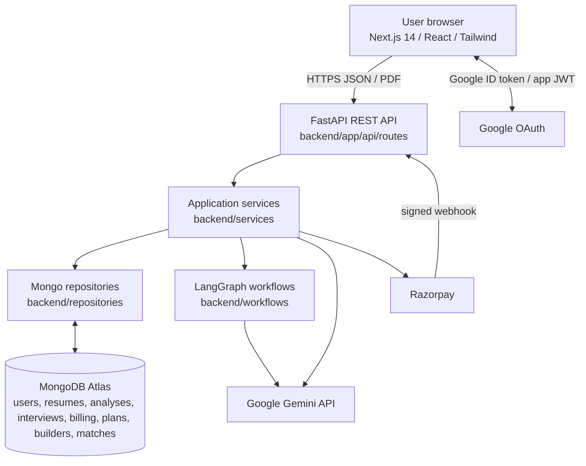

# Smart Interview architecture

## Runtime and configuration

- The frontend is a Next.js application deployed separately on Railway. It reads `NEXT_PUBLIC_API_URL` and `NEXT_PUBLIC_GOOGLE_CLIENT_ID` from its environment.
- The backend is a FastAPI application deployed separately on Railway. `backend/core/config/settings.py` reads MongoDB, OAuth, JWT, Gemini, CORS, and Razorpay settings from the process environment or local `backend/.env`.
- MongoDB access is initialized once in `backend/core/database.py`; asynchronous Motor repositories are injected into routes through `backend/core/dependencies.py`.
- Google ID tokens are verified by `backend/services/auth_service.py`; the API issues its own JWT. Subscription checkout and signed webhooks are handled by the billing routes and Razorpay service.
- AI calls use the configured Gemini model and retry/timeout policy in `backend/services/gemini_client.py`. Synchronous Gemini SDK and workflow calls are offloaded to worker threads from async services so slow generations do not block unrelated API requests.
- PDF exports choose an installed Unicode TTF font when available. On Railway, set `PDF_UNICODE_FONT_PATH` to a Unicode font file present in the API container if the default system-font paths are unavailable.

## Request path

`Next.js page/component → frontend/lib/api → FastAPI route → service → repository → MongoDB`. AI-enabled services also call Gemini directly or through a workflow. PDF endpoints return generated bytes. Authentication is a bearer JWT on API calls; payment confirmation is server verified and Razorpay events enter via webhook.

## Main MongoDB collections

`users`, `resumes`, `resume_analyses`, `interview_sessions`, `billing_subscriptions`, `billing_usage`, billing ledger/reservations/webhook events, `preparation_plans`, `resume_builders`, `job_matches`, and supporting application, institution, company preparation, and career-readiness collections.

## Deployment

Railway configuration lives in `backend/railway.toml` and `frontend/railway.toml`. Required variables and deployment steps are documented in `docs/RAILWAY_DEPLOY.md`. Do not commit local `.env` files or secret values.
